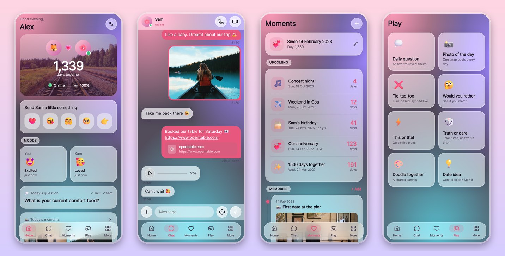
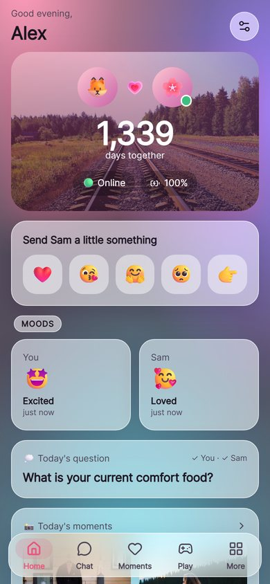
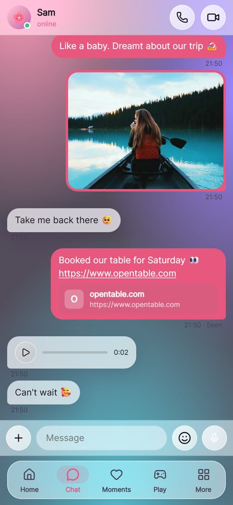
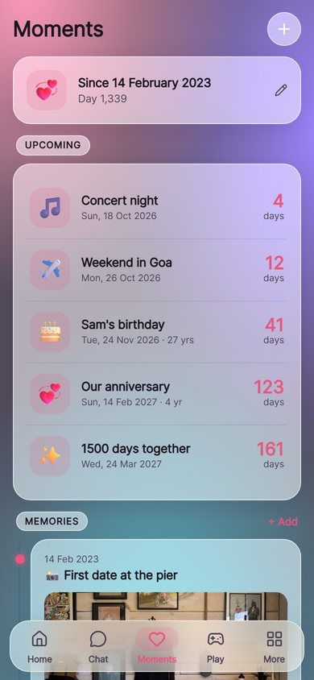
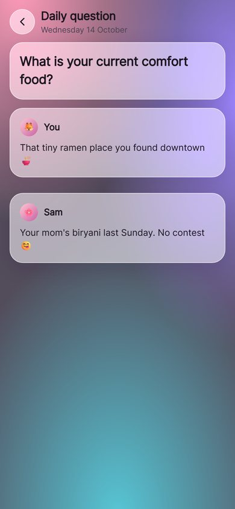
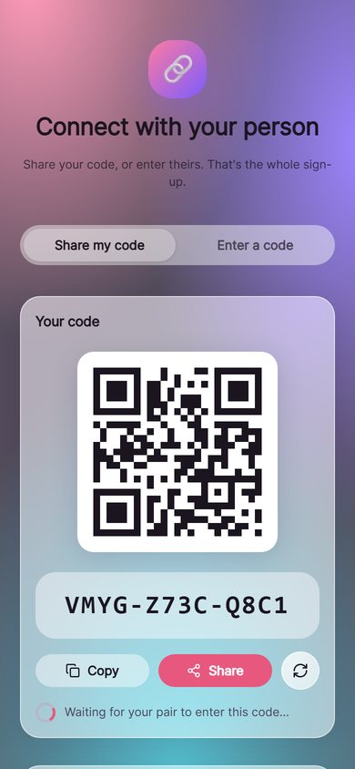
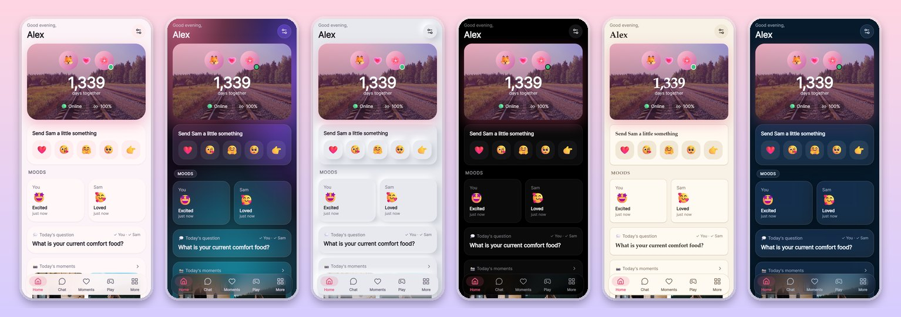

# OnePair 💞

A private little world for two: best friends or couples. **No backend, no accounts, no cloud.** Your two phones talk directly to each other over WebRTC, and everything you share lives only on those two devices, kept in sync automatically.

<p align="center">
  
</p>

<p align="center">
  <a href="https://github.com/ssuvamm/one-pair-app/releases/latest"><b>⬇️ Download the Android APK</b></a> ·
  <a href="https://ssuvamm.github.io/one-pair-app/"><b>🌐 Open the web app</b></a>
</p>

- **Pair with a code or QR code**: no sign-up, no email, no phone number
- **Chat**: text, photos, videos, voice notes, files, links, locations, reactions, replies
- **Voice and video calls**, peer-to-peer over STUN/TURN, ringing even while the app is in the background (Android)
- **Moments**: days together, anniversaries, birthdays, countdowns, a memories timeline, "On this day"
- **Play**: daily question (answer to reveal theirs), photo of the day, tic-tac-toe, Would You Rather, This or That, Truth or Dare, shared doodle canvas
- **Together**: shared lists, love jar, open-when letters, time capsules, gallery, links
- **Live location**, distance apart, partner's local time and battery
- **"Thinking of you" touches** with haptics
- **Gentle nudges** designed with psychology in mind (see [docs/RESEARCH.md](docs/RESEARCH.md)); notifications open the exact message or item
- **App lock**: PIN, or biometric with PIN fallback, plus a privacy cover in the app switcher
- **Six themes** (Material, Glass, Soft UI, AMOLED, Paper, Aurora), accent colours, daily, custom or shared wallpapers
- **Friends mode and Couple mode**, a start page you choose, and multiple pairs supported

## Support OnePair ☕

OnePair is free, ad-free and open source. If you'd like to support development:

- **PayPal:** [ssuvamm@gmail.com](https://www.paypal.com/donate/?business=ssuvamm%40gmail.com&no_recurring=0&item_name=Support%20OnePair)
- **UPI (India):** `ssuvamm@oksbi`

You can also find these in the app under **Settings → Support OnePair** and **About**.

## Screenshots

| Home | Chat | Moments | Daily question | Pairing |
|:---:|:---:|:---:|:---:|:---:|
|  |  |  |  |  |

**Six themes, each with light and dark modes:** Material, Glass, Soft UI, AMOLED, Paper, Aurora



## How it works

```
 Phone A                                                    Phone B
┌──────────────┐   encrypted WebRTC offer/answer (SDP)    ┌──────────────┐
│ Yjs document │ ───────► public Nostr relays ◄────────── │ Yjs document │
│ (IndexedDB)  │                                          │ (IndexedDB)  │
│              │ ◄══════ direct P2P data + media ═══════► │              │
└──────────────┘    (DTLS/SRTP; via TURN if NAT blocks)   └──────────────┘
```

1. **Pairing.** Person A shares a 12-character code. Person B enters it. Both join a rendezvous room derived from the code and run an ECDH key exchange. Both screens show the same 5 emojis, and A taps Accept. A then sends a random 256-bit **pair secret**, encrypted with the ECDH key.
2. **Private room.** The room id, signaling password and an HMAC key are all derived from the pair secret with HKDF. Signaling messages are AES-GCM encrypted, and a mutual challenge-response handshake lets only the paired device in.
3. **Sync.** All shared state (messages, days, lists, games, moods, locations…) is one [Yjs](https://yjs.dev) CRDT document per pair, persisted in IndexedDB. When the phones connect they exchange state vectors and send each other only what's missing. Edits made offline merge automatically.
4. **Media** is stored as blobs in IndexedDB and streamed over the data channel. Anything the other phone is missing is requested automatically on reconnect.
5. **Calls** use the same peer connection: ring, accept and end signals go over the data channel, and audio/video go over SRTP.

**Restore.** If someone reinstalls, the other person shares their code again, and when accepting picks **"Restore space with …"**. The full history syncs back. An encrypted backup file can also be exported from Settings.

**Limitations of having no server.** Messages are delivered when both apps are online at the same time; until then they wait on the sender's device. For a heads-up while the app is closed, enable optional **ntfy wake-up pings** (Settings → Connection). These are content-free notifications through [ntfy.sh](https://ntfy.sh) or your own ntfy server.

## Tech stack

| Concern | Choice |
|---|---|
| UI | React 19 + TypeScript, Vite, hand-written CSS themes (no UI framework, so the bundle stays small) |
| Native | Capacitor 8 (Android), plus an installable PWA |
| P2P | [Trystero](https://github.com/dmotz/trystero) (Nostr signaling) on WebRTC |
| Sync | Yjs + y-indexeddb |
| Crypto | WebCrypto: ECDH P-256, HKDF, AES-GCM, HMAC, PBKDF2 |
| Biometrics | `@aparajita/capacitor-biometric-auth` (native), WebAuthn platform authenticator (web) |
| Maps | Leaflet + OpenStreetMap |

The first load is about 150 KB gzipped. Every secondary screen is lazy-loaded, and chat renders a window of recent messages.

## Develop

```bash
npm install
npm run dev            # http://localhost:5173
npm run typecheck
npm run build          # PWA build into dist/
```

To test pairing locally, open the dev server at two **different origins** (for example `http://localhost:5173` and `http://127.0.0.1:5173`) so each has its own storage.

### Android

Requires JDK 21 and the Android SDK.

```bash
npm run cap:sync       # web build for Capacitor + copy into android/
npm run android:open   # open in Android Studio, or:
cd android && ./gradlew assembleDebug
```

## Releasing

Releases are fully automated by GitHub Actions. You only commit, tag and push.

1. Add your changes under `## [Unreleased]` in [CHANGELOG.md](CHANGELOG.md).
2. Run `npm run release -- 1.1.0`. This bumps the version and turns *Unreleased* into `## [1.1.0] - date`.
3. Commit, tag and push:
   ```bash
   git add -A && git commit -m "Release v1.1.0"
   git tag v1.1.0 && git push && git push origin v1.1.0
   ```

The **Release** workflow then:
- checks that the tag matches `package.json`, typechecks, and builds the PWA and the Android release APK (versionCode = `major*10000 + minor*100 + patch`)
- publishes a GitHub Release whose notes are the matching CHANGELOG section, with `OnePair-vX.Y.Z.apk`, `OnePair-vX.Y.Z-web.zip` and `SHA256SUMS.txt` attached
- deploys the PWA to GitHub Pages

The **CI** workflow runs on every push and PR: it typechecks, builds the web app, builds a debug APK (uploaded as an artifact), and validates the changelog.

### One-time repository setup

1. **Pages.** Go to Settings → Pages → Source and choose **GitHub Actions**.
2. **APK signing.** Without this, every release is signed with a throwaway debug key, so updates won't install over each other. Create a keystore once and keep it safe:
   ```bash
   keytool -genkeypair -v -keystore onepair.jks -alias onepair -keyalg RSA -keysize 4096 -validity 10000
   base64 -w0 onepair.jks   # macOS: base64 -i onepair.jks
   ```
   Then add these repository secrets (Settings → Secrets and variables → Actions):
   `ANDROID_KEYSTORE_BASE64`, `ANDROID_KEYSTORE_PASSWORD`, `ANDROID_KEY_ALIAS`, `ANDROID_KEY_PASSWORD`.
3. Replace `OWNER/REPO` in the links at the bottom of `CHANGELOG.md`.

## Connectivity

STUN servers (Google, Cloudflare, Twilio) are built in. Most home Wi-Fi works directly. Strict mobile networks need a **TURN** relay:
- A free community relay (Open Relay Project) is enabled by default. It's rate-limited and best-effort.
- For reliability, add your own under **More → Connection** (for example a self-hosted [coturn](https://github.com/coturn/coturn), Cloudflare Calls TURN, or a Metered.ca free-tier account). The **Test connectivity** button reports whether STUN and TURN are reachable.

Relayed traffic stays end-to-end encrypted. A TURN server only forwards encrypted packets.

## Privacy and security

- No analytics and no accounts. The only network peers are Nostr relays (which see encrypted, rotating signaling blobs), STUN/TURN servers, OpenStreetMap tiles, Picsum (daily images) and, if you enable it, ntfy.
- Android cloud backup and device-transfer are disabled for app data, so pair secrets never leave the phone.
- The PIN is a salted PBKDF2-SHA256 hash (210k iterations) with exponential back-off after 5 wrong attempts.

## Project layout

```
src/
  lib/            core: crypto, pairing, space (sync + P2P), calls, nudges, security, location…
  screens/        Home, Chat, Moments, Play, Games, Daily, PhotoOfDay, Doodle, Lists, Notes, Map, Settings…
  components/     shared UI and effects
  styles/app.css  design tokens and the six themes
android/          Capacitor Android project
scripts/          release helpers (changelog extraction, version checks)
.github/workflows CI + release
docs/RESEARCH.md  competitive research and nudge psychology
```
